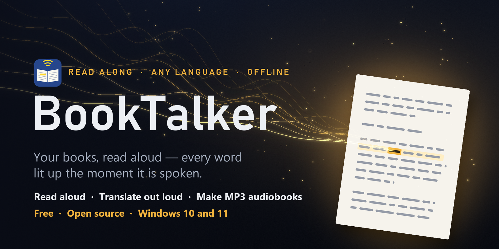
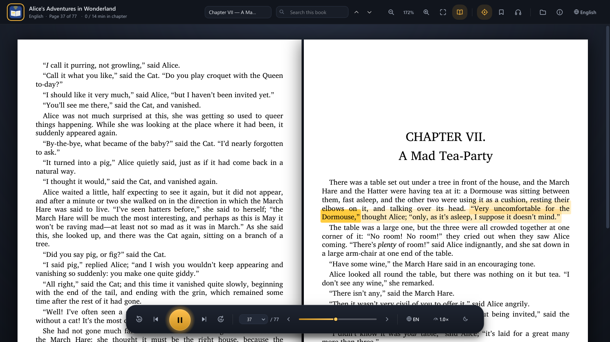
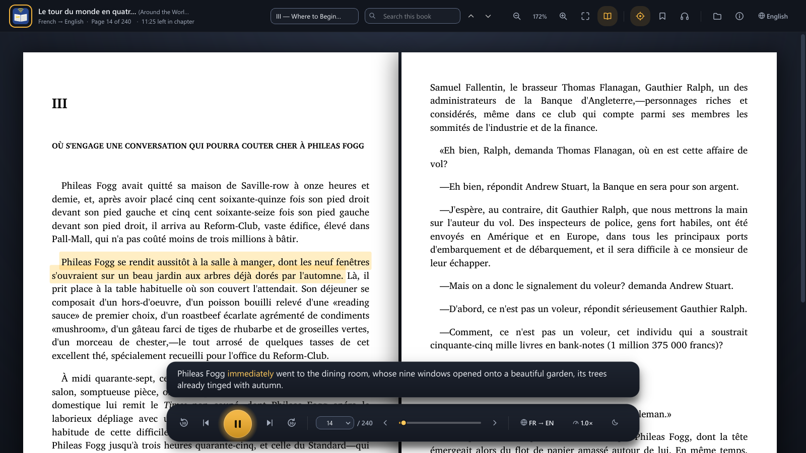

# BookTalker

BookTalker reads books aloud and lights up each word on the page as it is spoken, so you can
follow along. It is made for anyone who finds reading hard or tiring: children learning to read,
older readers, people with low vision or dyslexia, people learning a foreign language, audiobook
lovers and anyone who would rather listen.

It can also read a book written in another language out loud in yours, translating as it goes:
a French novel heard in English, a Russian one in Spanish. The original stays on the page and the
translation shows beneath it.

It runs entirely on your own computer. No account, no internet needed once installed, and your
books never leave your PC. It is free.

Made by Neal Strassner. If BookTalker helps you, you can buy him a coffee at
[ko-fi.com/nealstrassner](https://ko-fi.com/nealstrassner).

  
  

## What it does

- Opens nearly 200 file types: PDFs, e-books (EPUB, Kindle MOBI/AZW3, FB2), Word, PowerPoint,
  OpenDocument, WordPerfect, DjVu, Windows help files (CHM), Linux manual pages and Info manuals,
  the .nfo notes that come with programs, comics and manga (CBZ/CBR), web pages, e-mail, plain
  text, Markdown, scanned pages and photos of pages, and source code. The full list is
  [below](#files-it-opens).
- **Listen in your own language:** a book in any of about 120 languages is translated as it is
  read and heard in yours, the translation shown under the page. Offline: a fast translator is
  built in, and an optional AI translator gives the best quality.
- Reads in a natural voice and highlights each word as it is heard. Click any word to read from there.
- Understands the page: skips headers, footers and page numbers, joins words broken across lines,
  follows text across columns and pages, reads comic panels and speech balloons in order (manga
  right to left).
- Reads scanned books with its own text recognition, in Latin, Cyrillic, Greek, Arabic, Hebrew,
  Chinese, Japanese, Korean, Hindi, Bengali, Tamil, Telugu, Thai, Georgian, Armenian and more.
- One page at a time or two side by side like an open book; chapters with their listening
  times, search, bookmarks with notes, a sleep timer (minutes or "end of this chapter"),
  reading speed, and **Save as audiobook**: one MP3 per chapter in a folder named after the book,
  with a playlist for music players if you like (M3U8, M3U, PLS, XSPF or WPL).
- Computer code in a book can be explained in plain words or read out exactly.

## Files it opens

Every file is shown as book pages, read aloud with each word lit up, and can be searched,
bookmarked, translated and saved as an audiobook. Microsoft Office is not needed.

| Kind | File types |
|---|---|
| PDF | `.pdf`, including scanned PDFs (read with BookTalker's own text recognition) |
| E-books | EPUB `.epub` · Kindle `.mobi` `.azw3` `.azw` `.kf8` `.prc` `.pdb` · FictionBook `.fb2` `.fbz` · `.txtz` `.htmlz` |
| Scanned books and photos of pages | DjVu `.djvu` `.djv` · pictures `.png` `.jpg` `.jpeg` `.tif` `.tiff` `.bmp` `.gif` `.webp` |
| Comics and manga | `.cbz` `.cbr` `.cbt`: panels and speech balloons read in order, manga right to left |
| Word processing | Word `.docx` `.doc` `.docm` `.dotx` `.dot` · `.rtf` · OpenDocument `.odt` `.ott` · WordPerfect `.wpd` `.wp` `.wp4` `.wp5` `.wp6` |
| Slides | PowerPoint `.pptx` `.ppt` `.pptm` `.ppsx` `.pps` `.potx` · OpenDocument `.odp` `.otp` |
| Spreadsheets | OpenDocument `.ods` `.ots` |
| Web pages and e-mail | `.html` `.htm` `.xhtml` · saved web pages `.mht` `.mhtml` · e-mail `.eml` |
| Help files and manuals | Windows Help `.chm` · Linux and Unix manual pages `.1` to `.9` (also forms such as `.1p` `.3pm` `.1ssl` `.1x`) `.man` `.n` · GNU Info `.info` |
| Notes that come with programs | `.nfo` `.diz`: the ASCII-art logos and frames are skipped, the words are read |
| Other documents | XPS `.xps` `.oxps` · `.svg` |
| Plain text | `.txt` `.text` `.md` `.markdown` `.rst` `.adoc` `.asciidoc` `.org` `.tex` `.log` `.csv` `.tsv` |
| Packed with gzip | manual pages, Info manuals and plain text also open packed, as Linux keeps them: `ls.1.gz`, `tar.info.gz`, `notes.txt.gz` |
| Source code | `.py` `.pyw` `.js` `.mjs` `.cjs` `.ts` `.tsx` `.jsx` `.c` `.h` `.cpp` `.cc` `.cxx` `.hpp` `.hh` `.cs` `.java` `.go` `.rs` `.rb` `.php` `.swift` `.kt` `.kts` `.lua` `.sh` `.bash` `.zsh` `.ps1` `.psm1` `.bat` `.cmd` `.vbs` `.sql` `.r` `.pl` `.pm` `.scala` `.vb` `.bas` `.pas` `.dart` `.m` `.mm` `.f90` `.jl` `.hs` `.ex` `.exs` `.clj` `.erl` `.ml` `.fs` `.nim` `.zig` `.groovy` `.ino` `.css` `.scss` `.asm` `.s` `.mq4` `.mq5` `.pine` `.json` `.yaml` `.yml` `.toml` `.ini` `.cfg` `.xml` `.gradle` `.cmake` `.mk` `.dockerfile` |

Copy-protected (DRM) e-books can't be read aloud. DjVu books are read from their hidden text
layer, so pages without one come out blank.

## Install (Windows 10 and 11)

1. Download `BookTalker-Setup-<version>.exe` from the [Releases](../../releases) page.
2. Run it. It installs into Program Files for everyone on the PC; choose "only for me" if you
   have no administrator rights.
3. Windows may show "Windows protected your PC" (the installer is not code-signed): choose
   **More info → Run anyway**.

Voices, the AI translator, bookmarks, settings and prepared books are kept in your own user folder
(`%LOCALAPPDATA%\BookTalker`). Windows' list of programs shows them together with the program.
Uninstalling asks whether to remove them too.

BookTalker comes with one English voice and its fast translator. On first start it offers more
voices and the optional **AI translator** (2.6 GB, best quality, needs a graphics card). Nothing is
downloaded unless you choose it, and you can add any of them later.

**Updates:** when BookTalker opens, it asks this page whether a newer version is out (only the
list of releases is read; nothing about you or your books is sent). If there is one, a window asks
whether to update. **Update now** (or About → *Check for updates*) compares each of BookTalker's
files with the new version (by size and CRC), downloads only the files that changed, checks them,
copies them in and starts BookTalker again, keeping your books, bookmarks and voices. Apart from
that check, BookTalker goes online only to download something you chose (a voice, the AI
translator). Everything, translation included, runs offline on your own computer. See
[PRIVACY.txt](PRIVACY.txt).

## How to use

1. **Open a book:** click *Open a book*, drop a file onto the window, or pick one under
   *Continue reading*. A book opens where you left off.
2. **Press Play.** Each word lights up as it is spoken. Click any word to read from there.

The bar at the top:

- **Listening time**, beside the page number: how far you are into this chapter and how long it
  lasts at your reading speed (`6 / 18 min in chapter`). Click it to see the whole book instead.
  It is worked out from the voice's own pace, measured as it reads.
- **Chapters:** the book's chapters, each with its listening time. Choose one to read from its
  start.
- **Search this book:** every match is marked on the page.
- **Zoom** in and out, or fit the page to the window's width.
- **Two pages** side by side, like an open book.
- **Follow the voice:** keeps the spoken word in view. Turn it off to look around the book
  while it reads.
- **Bookmarks:** add one, with a note if you like, and go back to any of them.
- **Save as audiobook:** the whole book or a range of chapters, one MP3 per chapter. Tick
  *Make a playlist* and choose its type to get a playlist of them too.
- **Open**, **About** (version and updates) and the language of BookTalker's own menus
  (English, Spanish, French, German, Italian, Portuguese, Russian or Chinese).

The bar at the bottom:

- **Back or forward 30 seconds**, **previous or next sentence**, **Play / Pause**.
- **The page number** (type one to go there), **previous or next page**, and a slider through
  the book.
- **Language and voice** (the globe): the language the book is in, the language to listen in
  (the original or a translation), the voice, the translator (best quality AI, or fast), and
  what to do with computer code in a book (explain it in plain words, read it exactly as
  written, or skip it).
- **Reading speed:** from 0.75× to 1.75×.
- **Sleep timer** (the moon): stop after 5 to 120 minutes, at the end of this chapter, or at the
  end of a later one.

| Key | Does |
|---|---|
| Space | Play / Pause |
| ← / → | Previous / next sentence |
| Shift ← / Shift → | Back / forward 30 seconds |
| PgUp / PgDn | Previous / next page |
| [ / ] | Read slower / faster |
| Ctrl O | Open a book |
| Ctrl F | Search; then Enter for the next match, Shift Enter for the one before |
| Ctrl + / Ctrl − | Zoom in / out |
| Ctrl 0 | Fit the page width |
| Ctrl B | Add a bookmark |
| Ctrl Shift B | Add a bookmark with a note |

## What computer it needs

| | Minimum | Comfortable |
|---|---|---|
| Memory (RAM) | 4 GB | 8 GB |
| Disk space | 1.5 GB | 2 GB, plus voices (about 60 MB each) and the AI translator (2.6 GB) |
| Processor | any 64-bit, 2 cores | 4 cores or more |
| Graphics card | not needed | 3 GB free video memory for the optional AI translator |

Measured: reading a book uses about 1 GB of memory. With the optional AI translator running on the
graphics card, about 2 GB. Without a suitable graphics card BookTalker uses its fast built-in
translator automatically.

## Voices

BookTalker uses [Piper](https://github.com/OHF-voice/piper1-gpl) voices. The built-in English voice
is **Alba**. The voice picker lists over 100 more in about 45 languages, downloaded only when you
choose them, straight from the Piper voice collection. Hover over a voice to see the license of its
recordings.

## License

Copyright © 2026 Neal Strassner.

BookTalker is free software under the **GNU Affero General Public License v3** (`LICENSE`).

Some parts inside it have their own terms, listed in `THIRD_PARTY_NOTICES.md`. Two matter if you
want to reuse BookTalker:

- The built-in translator, **NLLB-200** by Meta AI, is licensed **for non-commercial use only**
  (CC BY-NC 4.0). Giving BookTalker away free is fine. Anyone who wants to sell a product built on
  BookTalker must replace it.
- The page-layout model, **Surya** by Datalab, is free for personal use, research, and
  organizations under US$5M revenue or funding (`licenses/SURYA_MODEL_LICENSE.txt`).

## Build from source

1. Install Python 3.12 and [uv](https://github.com/astral-sh/uv).
2. `uv venv .venv --python 3.12`, then `uv pip install --python .venv\Scripts\python.exe -r requirements.txt`.
3. Download `build-models.zip` and `nllb-200-distilled-600M-int8.zip` from the `models-1` release.
   Unpack the first into this folder (it fills `models/` and `voices/`) and the second into
   `models\nllb-600m-int8\`.
4. Run `build.bat`. The program is written to `dist\BookTalker\`.
5. Install [Inno Setup 6](https://jrsoftware.org/isinfo.php) and run
   `ISCC.exe installer\BookTalker.iss`. The installer is written to `installer\Output\`.
